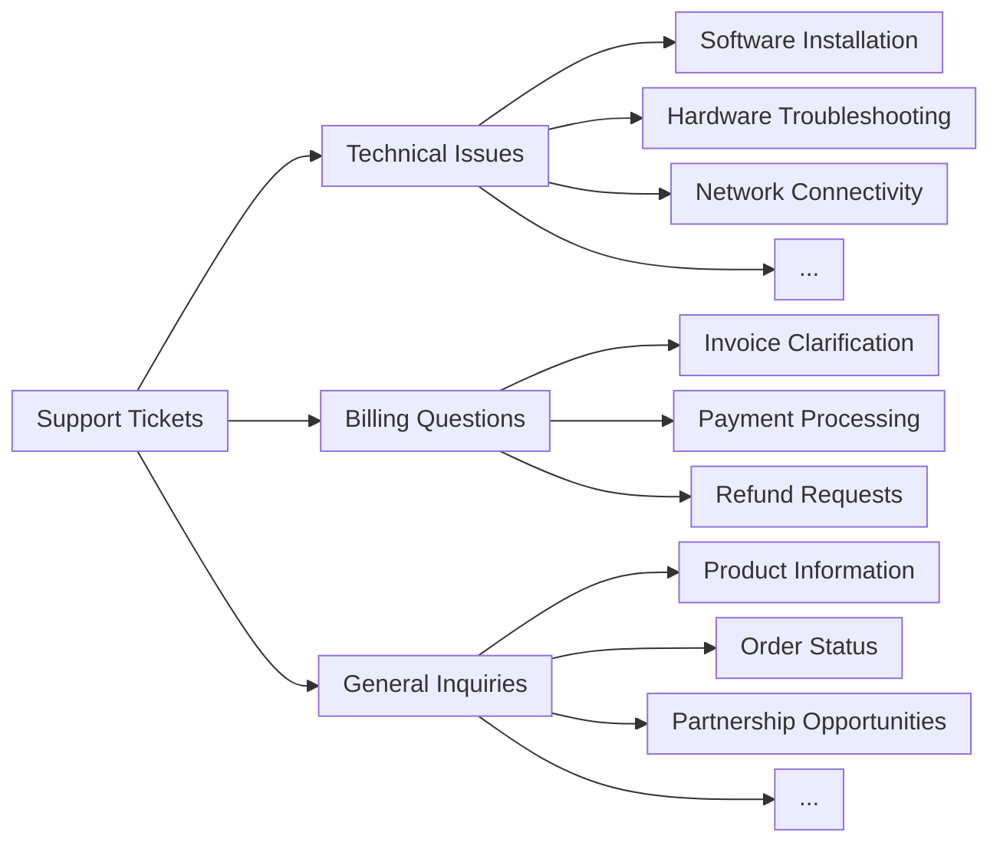

---
title: Perutean tiket
url: https://platform.claude.com/docs/id/about-claude/use-case-guides/ticket-routing
description: Panduan ini menjelaskan cara menggunakan kemampuan pemahaman bahasa alami tingkat lanjut Claude untuk mengklasifikasikan tiket dukungan pelanggan dalam skala besar berdasarkan maksud pelanggan, urgensi, prioritas, profil pelanggan, dan lainnya.
---

## Prasyarat

* Kunci API Claude dan Claude SDK yang sudah terinstal
* Akses ke, dan pemahaman tentang, sistem tiket dukungan Anda yang sudah ada
* Sekumpulan sampel tiket dukungan historis untuk pengujian

## Tentukan apakah akan menggunakan Claude untuk perutean tiket

Berikut adalah beberapa indikator utama bahwa Anda sebaiknya menggunakan "large language model" (model bahasa besar), atau LLM, seperti Claude alih-alih pendekatan ML tradisional untuk tugas klasifikasi Anda:

<AccordionGroup>
  <Accordion title="Anda memiliki data pelatihan berlabel yang terbatas">
    Proses ML tradisional memerlukan dataset berlabel yang sangat besar. Model Claude yang telah dilatih sebelumnya dapat mengklasifikasikan tiket secara efektif hanya dengan beberapa lusin contoh berlabel, sehingga secara signifikan mengurangi waktu dan biaya persiapan data.
  </Accordion>

  <Accordion title="Kategori klasifikasi Anda kemungkinan akan berubah atau berkembang seiring waktu">
    Setelah pendekatan ML tradisional ditetapkan, mengubahnya merupakan pekerjaan yang melelahkan dan membutuhkan banyak data. Di sisi lain, seiring berkembangnya produk atau kebutuhan pelanggan Anda, Claude dapat dengan mudah beradaptasi terhadap perubahan definisi kelas atau kelas baru tanpa pelabelan ulang data pelatihan secara ekstensif.
  </Accordion>

  <Accordion title="Anda perlu menangani input teks yang kompleks dan tidak terstruktur">
    Model ML tradisional sering kesulitan dengan data tidak terstruktur dan memerlukan rekayasa fitur yang ekstensif. Pemahaman bahasa tingkat lanjut Claude memungkinkan klasifikasi yang akurat berdasarkan konten dan konteks, alih-alih bergantung pada struktur ontologis yang kaku.
  </Accordion>

  <Accordion title="Aturan klasifikasi Anda didasarkan pada pemahaman semantik">
    Pendekatan ML tradisional sering bergantung pada model bag-of-words atau pencocokan pola sederhana. Claude unggul dalam menerapkan aturan dasar ketika kelas didefinisikan oleh kondisi, bukan oleh contoh.
  </Accordion>

  <Accordion title="Anda memerlukan penalaran yang dapat diinterpretasikan untuk keputusan klasifikasi">
    Banyak model ML tradisional memberikan sedikit wawasan tentang proses pengambilan keputusannya. Claude dapat memberikan penjelasan yang dapat dibaca manusia untuk keputusan klasifikasinya, membangun kepercayaan pada sistem otomatisasi dan memudahkan adaptasi jika diperlukan.
  </Accordion>

  <Accordion title="Anda ingin menangani kasus tepi dan tiket ambigu dengan lebih efektif">
    Sistem ML tradisional sering kesulitan dengan outlier dan input ambigu, sering kali salah mengklasifikasikannya atau memasukkannya ke kategori umum secara default. Kemampuan pemrosesan bahasa alami Claude memungkinkannya menafsirkan konteks dan nuansa dalam tiket dukungan dengan lebih baik, sehingga berpotensi mengurangi jumlah tiket yang salah dirutekan atau tidak terklasifikasi yang memerlukan intervensi manual.
  </Accordion>

  <Accordion title="Anda memerlukan dukungan multibahasa tanpa memelihara model terpisah">
    Pendekatan ML tradisional biasanya memerlukan model terpisah atau proses penerjemahan ekstensif untuk setiap bahasa yang didukung. Kemampuan multibahasa Claude memungkinkannya mengklasifikasikan tiket dalam berbagai bahasa tanpa memerlukan model terpisah atau proses penerjemahan ekstensif, sehingga menyederhanakan dukungan untuk basis pelanggan global.
  </Accordion>
</AccordionGroup>

***

## Bangun dan deploy alur kerja dukungan LLM Anda

### Pahami pendekatan dukungan Anda saat ini

Sebelum melakukan otomatisasi, sangat penting untuk memahami sistem tiket Anda yang sudah ada. Mulailah dengan menyelidiki bagaimana tim dukungan Anda saat ini menangani perutean tiket.

Pertimbangkan pertanyaan seperti:

* Kriteria apa yang digunakan untuk menentukan SLA/penawaran layanan apa yang diterapkan?
* Apakah perutean tiket digunakan untuk menentukan ke tingkat dukungan atau spesialis produk mana sebuah tiket diarahkan?
* Apakah sudah ada aturan atau alur kerja otomatis yang diterapkan? Dalam kasus apa aturan tersebut gagal?
* Bagaimana kasus tepi atau tiket ambigu ditangani?
* Bagaimana tim memprioritaskan tiket?

Semakin banyak Anda tahu tentang bagaimana manusia menangani kasus tertentu, semakin baik Anda dapat bekerja dengan Claude untuk melakukan tugas tersebut.

### Definisikan kategori maksud pengguna

Daftar kategori maksud pengguna yang terdefinisi dengan baik sangat penting untuk klasifikasi tiket dukungan yang akurat dengan Claude. Kemampuan Claude untuk merutekan tiket secara efektif dalam sistem Anda berbanding lurus dengan seberapa baik kategori sistem Anda didefinisikan.

Berikut adalah beberapa contoh kategori dan subkategori maksud pengguna.

<AccordionGroup>
  <Accordion title="Masalah teknis">
    * Masalah perangkat keras
    * Bug perangkat lunak
    * Masalah kompatibilitas
    * Masalah performa
  </Accordion>

  <Accordion title="Manajemen akun">
    * Reset kata sandi
    * Masalah akses akun
    * Pertanyaan penagihan
    * Perubahan langganan
  </Accordion>

  <Accordion title="Informasi produk">
    * Pertanyaan fitur
    * Pertanyaan kompatibilitas produk
    * Informasi harga
    * Pertanyaan ketersediaan
  </Accordion>

  <Accordion title="Panduan pengguna">
    * Pertanyaan cara melakukan sesuatu
    * Bantuan penggunaan fitur
    * Saran praktik terbaik
    * Panduan pemecahan masalah
  </Accordion>

  <Accordion title="Umpan balik">
    * Laporan bug
    * Permintaan fitur
    * Umpan balik atau saran umum
    * Keluhan
  </Accordion>

  <Accordion title="Terkait pesanan">
    * Pertanyaan status pesanan
    * Informasi pengiriman
    * Pengembalian dan penukaran
    * Modifikasi pesanan
  </Accordion>

  <Accordion title="Permintaan layanan">
    * Bantuan instalasi
    * Permintaan upgrade
    * Penjadwalan pemeliharaan
    * Pembatalan layanan
  </Accordion>

  <Accordion title="Masalah keamanan">
    * Pertanyaan privasi data
    * Laporan aktivitas mencurigakan
    * Bantuan fitur keamanan
  </Accordion>

  <Accordion title="Kepatuhan dan hukum">
    * Pertanyaan kepatuhan regulasi
    * Pertanyaan ketentuan layanan
    * Permintaan dokumentasi hukum
  </Accordion>

  <Accordion title="Dukungan darurat">
    * Kegagalan sistem kritis
    * Masalah keamanan mendesak
    * Masalah yang sensitif terhadap waktu
  </Accordion>

  <Accordion title="Pelatihan dan edukasi">
    * Permintaan pelatihan produk
    * Pertanyaan dokumentasi
    * Informasi webinar atau lokakarya
  </Accordion>

  <Accordion title="Integrasi dan API">
    * Bantuan integrasi
    * Pertanyaan penggunaan API
    * Pertanyaan kompatibilitas pihak ketiga
  </Accordion>
</AccordionGroup>

Selain maksud, perutean dan prioritas tiket juga dapat dipengaruhi oleh faktor lain seperti urgensi, jenis pelanggan, SLA, atau bahasa. Pastikan untuk mempertimbangkan kriteria perutean lainnya saat membangun sistem perutean otomatis Anda.

### Tetapkan kriteria keberhasilan

Bekerja samalah dengan tim dukungan Anda untuk [mendefinisikan kriteria keberhasilan yang jelas](https://platform.claude.com/docs/id/test-and-evaluate/develop-tests) dengan tolok ukur, ambang batas, dan tujuan yang terukur.

Berikut adalah beberapa kriteria dan tolok ukur standar saat menggunakan LLM untuk perutean tiket dukungan:

<AccordionGroup>
  <Accordion title="Konsistensi klasifikasi">
    Metrik ini menilai seberapa konsisten Claude mengklasifikasikan tiket serupa dari waktu ke waktu. Hal ini sangat penting untuk menjaga keandalan perutean. Ukur ini dengan menguji model secara berkala menggunakan sekumpulan input terstandarisasi dan targetkan tingkat konsistensi 95 persen atau lebih tinggi.
  </Accordion>

  <Accordion title="Kecepatan adaptasi">
    Ini mengukur seberapa cepat Claude dapat beradaptasi dengan kategori baru atau pola tiket yang berubah. Uji ini dengan memperkenalkan jenis tiket baru dan mengukur waktu yang dibutuhkan model untuk mencapai akurasi yang memuaskan (misalnya, lebih dari 90 persen) pada kategori baru tersebut. Targetkan adaptasi dalam 50–100 tiket sampel.
  </Accordion>

  <Accordion title="Penanganan multibahasa">
    Ini menilai kemampuan Claude untuk merutekan tiket secara akurat dalam berbagai bahasa. Ukur akurasi perutean di berbagai bahasa, dengan target penurunan akurasi tidak lebih dari 5–10 persen untuk bahasa non-utama.
  </Accordion>

  <Accordion title="Penanganan kasus tepi">
    Ini mengevaluasi performa Claude pada tiket yang tidak biasa atau kompleks. Buat set pengujian kasus tepi dan ukur akurasi perutean, dengan target akurasi minimal 80 persen pada input yang menantang ini.
  </Accordion>

  <Accordion title="Mitigasi bias">
    Ini mengukur keadilan Claude dalam perutean di berbagai demografi pelanggan. Audit keputusan perutean secara teratur untuk mendeteksi potensi bias, dengan target akurasi perutean yang konsisten (dalam rentang 2–3 persen) di semua kelompok pelanggan.
  </Accordion>

  <Accordion title="Efisiensi prompt">
    Dalam situasi di mana meminimalkan jumlah token sangat penting, kriteria ini menilai seberapa baik performa Claude dengan konteks minimal. Ukur akurasi perutean dengan jumlah konteks yang bervariasi, dengan target akurasi minimal 90 persen hanya dengan judul tiket dan deskripsi singkat.
  </Accordion>

  <Accordion title="Skor keterjelasan">
    Ini mengevaluasi kualitas dan relevansi penjelasan Claude atas keputusan peruteannya. Penilai manusia dapat memberi skor penjelasan pada suatu skala (misalnya, 1–5), dengan tujuan mencapai skor rata-rata 4 atau lebih tinggi.
  </Accordion>
</AccordionGroup>

Berikut adalah beberapa kriteria keberhasilan umum yang mungkin berguna terlepas dari apakah LLM digunakan atau tidak:

<AccordionGroup>
  <Accordion title="Akurasi perutean">
    Akurasi perutean mengukur seberapa sering tiket ditugaskan dengan benar ke tim atau individu yang tepat pada percobaan pertama. Ini biasanya diukur sebagai persentase tiket yang dirutekan dengan benar dari total tiket. Tolok ukur industri sering menargetkan akurasi 90–95 persen, meskipun hal ini dapat bervariasi tergantung pada kompleksitas struktur dukungan.
  </Accordion>

  <Accordion title="Waktu hingga penugasan">
    Metrik ini melacak seberapa cepat tiket ditugaskan setelah dikirimkan. Waktu penugasan yang lebih cepat umumnya menghasilkan penyelesaian yang lebih cepat dan kepuasan pelanggan yang lebih baik. Sistem terbaik di kelasnya sering mencapai waktu penugasan rata-rata di bawah 5 menit, dengan banyak yang menargetkan perutean hampir seketika (yang dimungkinkan dengan implementasi LLM).
  </Accordion>

  <Accordion title="Tingkat perutean ulang">
    Tingkat perutean ulang menunjukkan seberapa sering tiket perlu ditugaskan ulang setelah perutean awal. Tingkat yang lebih rendah menunjukkan perutean awal yang lebih akurat. Targetkan tingkat perutean ulang di bawah 10 persen, dengan sistem berkinerja terbaik mencapai tingkat serendah 5 persen atau kurang.
  </Accordion>

  <Accordion title="Tingkat penyelesaian kontak pertama">
    Ini mengukur persentase tiket yang diselesaikan selama interaksi pertama dengan pelanggan. Tingkat yang lebih tinggi menunjukkan perutean yang efisien dan tim dukungan yang siap. Tolok ukur industri biasanya berkisar antara 70 hingga 75 persen, dengan pihak berkinerja terbaik mencapai tingkat 80 persen atau lebih tinggi.
  </Accordion>

  <Accordion title="Waktu penanganan rata-rata">
    Waktu penanganan rata-rata mengukur berapa lama waktu yang dibutuhkan untuk menyelesaikan tiket dari awal hingga akhir. Perutean yang efisien dapat secara signifikan mengurangi waktu ini. Tolok ukur sangat bervariasi menurut industri dan kompleksitas, tetapi banyak organisasi menargetkan waktu penanganan rata-rata di bawah 24 jam untuk masalah non-kritis.
  </Accordion>

  <Accordion title="Skor kepuasan pelanggan">
    Sering diukur melalui survei pasca-interaksi, skor ini mencerminkan kepuasan pelanggan secara keseluruhan terhadap proses dukungan. Perutean yang efektif berkontribusi pada kepuasan yang lebih tinggi. Targetkan skor CSAT 90 persen atau lebih tinggi, dengan pihak berkinerja terbaik sering mencapai tingkat kepuasan minimal 95 persen.
  </Accordion>

  <Accordion title="Tingkat eskalasi">
    Ini mengukur seberapa sering tiket perlu dieskalasi ke tingkat dukungan yang lebih tinggi. Tingkat eskalasi yang lebih rendah sering menunjukkan perutean awal yang lebih akurat. Upayakan tingkat eskalasi di bawah 20 persen, dengan sistem terbaik di kelasnya mencapai tingkat 10 persen atau kurang.
  </Accordion>

  <Accordion title="Produktivitas agen">
    Metrik ini melihat berapa banyak tiket yang dapat ditangani agen secara efektif setelah menerapkan solusi perutean. Perutean yang lebih baik seharusnya meningkatkan produktivitas. Ukur ini dengan melacak tiket yang diselesaikan per agen per hari atau jam, dengan target peningkatan 10–20 persen setelah menerapkan sistem perutean baru.
  </Accordion>

  <Accordion title="Tingkat defleksi layanan mandiri">
    Ini mengukur persentase tiket potensial yang diselesaikan melalui opsi layanan mandiri sebelum masuk ke sistem perutean. Tingkat yang lebih tinggi menunjukkan triase pra-perutean yang efektif. Targetkan tingkat defleksi 20–30 persen, dengan pihak berkinerja terbaik mencapai tingkat 40 persen atau lebih tinggi.
  </Accordion>

  <Accordion title="Biaya per tiket">
    Metrik ini menghitung biaya rata-rata untuk menyelesaikan setiap tiket dukungan. Perutean yang efisien seharusnya membantu mengurangi biaya ini seiring waktu. Meskipun tolok ukur sangat bervariasi, banyak organisasi menargetkan pengurangan biaya per tiket sebesar 10–15 persen setelah menerapkan sistem perutean yang lebih baik.
  </Accordion>
</AccordionGroup>

### Pilih model Claude yang tepat

Pilihan model bergantung pada pertukaran antara biaya, akurasi, dan waktu respons.

Claude Haiku 5.5 (`claude-haiku-5-5`) cocok untuk perutean tiket: model ini adalah model saat ini yang tercepat dan paling hemat biaya, dan pada effort `low` model ini dapat menangani permintaan sederhana bervolume tinggi seperti klasifikasi. Jika masalah klasifikasi Anda memerlukan keahlian mendalam di bidang tertentu, kategori maksud dalam jumlah besar, atau penalaran yang kompleks, Anda dapat memilih [model Sonnet yang lebih besar](https://platform.claude.com/docs/id/models/overview).

### Bangun prompt yang kuat

Perutean tiket adalah jenis tugas klasifikasi. Claude menganalisis konten tiket dukungan dan mengklasifikasikannya ke dalam kategori yang telah ditentukan berdasarkan jenis masalah, urgensi, keahlian yang diperlukan, atau faktor relevan lainnya.

Tulis prompt klasifikasi tiket. Prompt awal harus berisi konten permintaan pengguna dan mengembalikan penalaran serta maksudnya.

<Tip>
  Coba [resep metaprompt dari Claude Cookbook](https://colab.research.google.com/github/anthropics/claude-cookbooks/blob/main/misc/metaprompt.ipynb) agar Claude menulis draf pertama untuk Anda.
</Tip>

Berikut adalah contoh prompt klasifikasi perutean tiket:

<CodeGroup exclude="shell">
  <CodeGroupItem language="cURL">
    Bangun prompt di dalam kode.
  </CodeGroupItem>

  <CodeGroupItem language="CLI">
    Bangun prompt di dalam kode.
  </CodeGroupItem>

  ```python Python
  def classify_support_request(ticket_contents):
      # Definisikan prompt untuk tugas klasifikasi
      classification_prompt = f"""You will be acting as a customer support ticket classification system. Your task is to analyze customer support requests and output the appropriate classification intent for each request, along with your reasoning.

          Here is the customer support request you need to classify:

          <request>{ticket_contents}</request>

          Please carefully analyze the above request to determine the customer's core intent and needs. Consider what the customer is asking for has concerns about.

          First, write out your reasoning and analysis of how to classify this request inside <reasoning> tags.

          Then, output the appropriate classification label for the request inside a <intent> tag. The valid intents are:
          <intents>
          <intent>Support, Feedback, Complaint</intent>
          <intent>Order Tracking</intent>
          <intent>Refund/Exchange</intent>
          </intents>

          A request may have ONLY ONE applicable intent. Only include the intent that is most applicable to the request.

          As an example, consider the following request:
          <request>Hello! I had high-speed fiber internet installed on Saturday and my installer, Kevin, was absolutely fantastic! Where can I send my positive review? Thanks for your help!</request>

          Here is an example of how your output should be formatted (for the above example request):
          <reasoning>The user seeks information in order to leave positive feedback.</reasoning>
          <intent>Support, Feedback, Complaint</intent>

          Here are a few more examples:
          <examples>
          <example 2>
          Example 2 Input:
          <request>I wanted to write and personally thank you for the compassion you showed towards my family during my father's funeral this past weekend. Your staff was so considerate and helpful throughout this whole process; it really took a load off our shoulders. The visitation brochures were beautiful. We'll never forget the kindness you showed us and we are so appreciative of how smoothly the proceedings went. Thank you, again, Amarantha Hill on behalf of the Hill Family.</request>

          Example 2 Output:
          <reasoning>User leaves a positive review of their experience.</reasoning>
          <intent>Support, Feedback, Complaint</intent>
          </example 2>
          <example 3>

          […]

          </example 8>
          <example 9>
          Example 9 Input:
          <request>Your website keeps sending ad-popups that block the entire screen. It took me twenty minutes just to finally find the phone number to call and complain. How can I possibly access my account information with all of these popups? Can you access my account for me, since your website is broken? I need to know what the address is on file.</request>

          Example 9 Output:
          <reasoning>The user requests help accessing their web account information.</reasoning>
          <intent>Support, Feedback, Complaint</intent>
          </example 9>

          Remember to always include your classification reasoning before your actual intent output. The reasoning should be enclosed in <reasoning> tags and the intent in <intent> tags. Return only the reasoning and the intent.
          """
  ```

  ```typescript TypeScript
  function classifySupportRequest(ticketContents: string) {
    // Definisikan prompt untuk tugas klasifikasi
    const classificationPrompt = `You will be acting as a customer support ticket classification system. Your task is to analyze customer support requests and output the appropriate classification intent for each request, along with your reasoning.

      Here is the customer support request you need to classify:

      <request>${ticketContents}</request>

      Please carefully analyze the above request to determine the customer's core intent and needs. Consider what the customer is asking for has concerns about.

      First, write out your reasoning and analysis of how to classify this request inside <reasoning> tags.

      Then, output the appropriate classification label for the request inside a <intent> tag. The valid intents are:
      <intents>
      <intent>Support, Feedback, Complaint</intent>
      <intent>Order Tracking</intent>
      <intent>Refund/Exchange</intent>
      </intents>

      A request may have ONLY ONE applicable intent. Only include the intent that is most applicable to the request.

      As an example, consider the following request:
      <request>Hello! I had high-speed fiber internet installed on Saturday and my installer, Kevin, was absolutely fantastic! Where can I send my positive review? Thanks for your help!</request>

      Here is an example of how your output should be formatted (for the above example request):
      <reasoning>The user seeks information in order to leave positive feedback.</reasoning>
      <intent>Support, Feedback, Complaint</intent>

      Here are a few more examples:
      <examples>
      <example 2>
      Example 2 Input:
      <request>I wanted to write and personally thank you for the compassion you showed towards my family during my father's funeral this past weekend. Your staff was so considerate and helpful throughout this whole process; it really took a load off our shoulders. The visitation brochures were beautiful. We'll never forget the kindness you showed us and we are so appreciative of how smoothly the proceedings went. Thank you, again, Amarantha Hill on behalf of the Hill Family.</request>

      Example 2 Output:
      <reasoning>User leaves a positive review of their experience.</reasoning>
      <intent>Support, Feedback, Complaint</intent>
      </example 2>
      <example 3>

      […]

      </example 8>
      <example 9>
      Example 9 Input:
      <request>Your website keeps sending ad-popups that block the entire screen. It took me twenty minutes just to finally find the phone number to call and complain. How can I possibly access my account information with all of these popups? Can you access my account for me, since your website is broken? I need to know what the address is on file.</request>

      Example 9 Output:
      <reasoning>The user requests help accessing their web account information.</reasoning>
      <intent>Support, Feedback, Complaint</intent>
      </example 9>

      Remember to always include your classification reasoning before your actual intent output. The reasoning should be enclosed in <reasoning> tags and the intent in <intent> tags. Return only the reasoning and the intent.
      `;
  }
  ```

  ```csharp C#
  void ClassifySupportRequest(string ticketContents)
  {
      // Definisikan prompt untuk tugas klasifikasi
      var classificationPrompt = $"""
          You will be acting as a customer support ticket classification system. Your task is to analyze customer support requests and output the appropriate classification intent for each request, along with your reasoning.

          Here is the customer support request you need to classify:

          <request>{ticketContents}</request>

          Please carefully analyze the above request to determine the customer's core intent and needs. Consider what the customer is asking for has concerns about.

          First, write out your reasoning and analysis of how to classify this request inside <reasoning> tags.

          Then, output the appropriate classification label for the request inside a <intent> tag. The valid intents are:
          <intents>
          <intent>Support, Feedback, Complaint</intent>
          <intent>Order Tracking</intent>
          <intent>Refund/Exchange</intent>
          </intents>

          A request may have ONLY ONE applicable intent. Only include the intent that is most applicable to the request.

          As an example, consider the following request:
          <request>Hello! I had high-speed fiber internet installed on Saturday and my installer, Kevin, was absolutely fantastic! Where can I send my positive review? Thanks for your help!</request>

          Here is an example of how your output should be formatted (for the above example request):
          <reasoning>The user seeks information in order to leave positive feedback.</reasoning>
          <intent>Support, Feedback, Complaint</intent>

          Here are a few more examples:
          <examples>
          <example 2>
          Example 2 Input:
          <request>I wanted to write and personally thank you for the compassion you showed towards my family during my father's funeral this past weekend. Your staff was so considerate and helpful throughout this whole process; it really took a load off our shoulders. The visitation brochures were beautiful. We'll never forget the kindness you showed us and we are so appreciative of how smoothly the proceedings went. Thank you, again, Amarantha Hill on behalf of the Hill Family.</request>

          Example 2 Output:
          <reasoning>User leaves a positive review of their experience.</reasoning>
          <intent>Support, Feedback, Complaint</intent>
          </example 2>
          <example 3>

          […]

          </example 8>
          <example 9>
          Example 9 Input:
          <request>Your website keeps sending ad-popups that block the entire screen. It took me twenty minutes just to finally find the phone number to call and complain. How can I possibly access my account information with all of these popups? Can you access my account for me, since your website is broken? I need to know what the address is on file.</request>

          Example 9 Output:
          <reasoning>The user requests help accessing their web account information.</reasoning>
          <intent>Support, Feedback, Complaint</intent>
          </example 9>

          Remember to always include your classification reasoning before your actual intent output. The reasoning should be enclosed in <reasoning> tags and the intent in <intent> tags. Return only the reasoning and the intent.
          """;
  }
  ```

  ```go Go
  func classifySupportRequest(ticketContents string) {
  	// Definisikan prompt untuk tugas klasifikasi
  	classificationPrompt := `You will be acting as a customer support ticket classification system. Your task is to analyze customer support requests and output the appropriate classification intent for each request, along with your reasoning.

  		Here is the customer support request you need to classify:

  		<request>` + ticketContents + `</request>

  		Please carefully analyze the above request to determine the customer's core intent and needs. Consider what the customer is asking for has concerns about.

  		First, write out your reasoning and analysis of how to classify this request inside <reasoning> tags.

  		Then, output the appropriate classification label for the request inside a <intent> tag. The valid intents are:
  		<intents>
  		<intent>Support, Feedback, Complaint</intent>
  		<intent>Order Tracking</intent>
  		<intent>Refund/Exchange</intent>
  		</intents>

  		A request may have ONLY ONE applicable intent. Only include the intent that is most applicable to the request.

  		As an example, consider the following request:
  		<request>Hello! I had high-speed fiber internet installed on Saturday and my installer, Kevin, was absolutely fantastic! Where can I send my positive review? Thanks for your help!</request>

  		Here is an example of how your output should be formatted (for the above example request):
  		<reasoning>The user seeks information in order to leave positive feedback.</reasoning>
  		<intent>Support, Feedback, Complaint</intent>

  		Here are a few more examples:
  		<examples>
  		<example 2>
  		Example 2 Input:
  		<request>I wanted to write and personally thank you for the compassion you showed towards my family during my father's funeral this past weekend. Your staff was so considerate and helpful throughout this whole process; it really took a load off our shoulders. The visitation brochures were beautiful. We'll never forget the kindness you showed us and we are so appreciative of how smoothly the proceedings went. Thank you, again, Amarantha Hill on behalf of the Hill Family.</request>

  		Example 2 Output:
  		<reasoning>User leaves a positive review of their experience.</reasoning>
  		<intent>Support, Feedback, Complaint</intent>
  		</example 2>
  		<example 3>

  		[…]

  		</example 8>
  		<example 9>
  		Example 9 Input:
  		<request>Your website keeps sending ad-popups that block the entire screen. It took me twenty minutes just to finally find the phone number to call and complain. How can I possibly access my account information with all of these popups? Can you access my account for me, since your website is broken? I need to know what the address is on file.</request>

  		Example 9 Output:
  		<reasoning>The user requests help accessing their web account information.</reasoning>
  		<intent>Support, Feedback, Complaint</intent>
  		</example 9>

  		Remember to always include your classification reasoning before your actual intent output. The reasoning should be enclosed in <reasoning> tags and the intent in <intent> tags. Return only the reasoning and the intent.
  		`
  // ...
  }
  ```

  ```java Java
  void classifySupportRequest(String ticketContents) {
      // Definisikan prompt untuk tugas klasifikasi
      String classificationPrompt = """
          You will be acting as a customer support ticket classification system. Your task is to analyze customer support requests and output the appropriate classification intent for each request, along with your reasoning.

          Here is the customer support request you need to classify:

          <request>%s</request>

          Please carefully analyze the above request to determine the customer's core intent and needs. Consider what the customer is asking for has concerns about.

          First, write out your reasoning and analysis of how to classify this request inside <reasoning> tags.

          Then, output the appropriate classification label for the request inside a <intent> tag. The valid intents are:
          <intents>
          <intent>Support, Feedback, Complaint</intent>
          <intent>Order Tracking</intent>
          <intent>Refund/Exchange</intent>
          </intents>

          A request may have ONLY ONE applicable intent. Only include the intent that is most applicable to the request.

          As an example, consider the following request:
          <request>Hello! I had high-speed fiber internet installed on Saturday and my installer, Kevin, was absolutely fantastic! Where can I send my positive review? Thanks for your help!</request>

          Here is an example of how your output should be formatted (for the above example request):
          <reasoning>The user seeks information in order to leave positive feedback.</reasoning>
          <intent>Support, Feedback, Complaint</intent>

          Here are a few more examples:
          <examples>
          <example 2>
          Example 2 Input:
          <request>I wanted to write and personally thank you for the compassion you showed towards my family during my father's funeral this past weekend. Your staff was so considerate and helpful throughout this whole process; it really took a load off our shoulders. The visitation brochures were beautiful. We'll never forget the kindness you showed us and we are so appreciative of how smoothly the proceedings went. Thank you, again, Amarantha Hill on behalf of the Hill Family.</request>

          Example 2 Output:
          <reasoning>User leaves a positive review of their experience.</reasoning>
          <intent>Support, Feedback, Complaint</intent>
          </example 2>
          <example 3>

          […]

          </example 8>
          <example 9>
          Example 9 Input:
          <request>Your website keeps sending ad-popups that block the entire screen. It took me twenty minutes just to finally find the phone number to call and complain. How can I possibly access my account information with all of these popups? Can you access my account for me, since your website is broken? I need to know what the address is on file.</request>

          Example 9 Output:
          <reasoning>The user requests help accessing their web account information.</reasoning>
          <intent>Support, Feedback, Complaint</intent>
          </example 9>

          Remember to always include your classification reasoning before your actual intent output. The reasoning should be enclosed in <reasoning> tags and the intent in <intent> tags. Return only the reasoning and the intent.
          """.formatted(ticketContents);
  }
  ```

  ```php PHP
  function classifySupportRequest(string $ticketContents): void
  {
      // Definisikan prompt untuk tugas klasifikasi
      $classificationPrompt = <<<PROMPT
          You will be acting as a customer support ticket classification system. Your task is to analyze customer support requests and output the appropriate classification intent for each request, along with your reasoning.

          Here is the customer support request you need to classify:

          <request>{$ticketContents}</request>

          Please carefully analyze the above request to determine the customer's core intent and needs. Consider what the customer is asking for has concerns about.

          First, write out your reasoning and analysis of how to classify this request inside <reasoning> tags.

          Then, output the appropriate classification label for the request inside a <intent> tag. The valid intents are:
          <intents>
          <intent>Support, Feedback, Complaint</intent>
          <intent>Order Tracking</intent>
          <intent>Refund/Exchange</intent>
          </intents>

          A request may have ONLY ONE applicable intent. Only include the intent that is most applicable to the request.

          As an example, consider the following request:
          <request>Hello! I had high-speed fiber internet installed on Saturday and my installer, Kevin, was absolutely fantastic! Where can I send my positive review? Thanks for your help!</request>

          Here is an example of how your output should be formatted (for the above example request):
          <reasoning>The user seeks information in order to leave positive feedback.</reasoning>
          <intent>Support, Feedback, Complaint</intent>

          Here are a few more examples:
          <examples>
          <example 2>
          Example 2 Input:
          <request>I wanted to write and personally thank you for the compassion you showed towards my family during my father's funeral this past weekend. Your staff was so considerate and helpful throughout this whole process; it really took a load off our shoulders. The visitation brochures were beautiful. We'll never forget the kindness you showed us and we are so appreciative of how smoothly the proceedings went. Thank you, again, Amarantha Hill on behalf of the Hill Family.</request>

          Example 2 Output:
          <reasoning>User leaves a positive review of their experience.</reasoning>
          <intent>Support, Feedback, Complaint</intent>
          </example 2>
          <example 3>

          […]

          </example 8>
          <example 9>
          Example 9 Input:
          <request>Your website keeps sending ad-popups that block the entire screen. It took me twenty minutes just to finally find the phone number to call and complain. How can I possibly access my account information with all of these popups? Can you access my account for me, since your website is broken? I need to know what the address is on file.</request>

          Example 9 Output:
          <reasoning>The user requests help accessing their web account information.</reasoning>
          <intent>Support, Feedback, Complaint</intent>
          </example 9>

          Remember to always include your classification reasoning before your actual intent output. The reasoning should be enclosed in <reasoning> tags and the intent in <intent> tags. Return only the reasoning and the intent.
          PROMPT;
  }
  ```

  ```ruby Ruby
  def classify_support_request(ticket_contents)
    # Definisikan prompt untuk tugas klasifikasi
    classification_prompt = <<~PROMPT
      You will be acting as a customer support ticket classification system. Your task is to analyze customer support requests and output the appropriate classification intent for each request, along with your reasoning.

      Here is the customer support request you need to classify:

      <request>#{ticket_contents}</request>

      Please carefully analyze the above request to determine the customer's core intent and needs. Consider what the customer is asking for has concerns about.

      First, write out your reasoning and analysis of how to classify this request inside <reasoning> tags.

      Then, output the appropriate classification label for the request inside a <intent> tag. The valid intents are:
      <intents>
      <intent>Support, Feedback, Complaint</intent>
      <intent>Order Tracking</intent>
      <intent>Refund/Exchange</intent>
      </intents>

      A request may have ONLY ONE applicable intent. Only include the intent that is most applicable to the request.

      As an example, consider the following request:
      <request>Hello! I had high-speed fiber internet installed on Saturday and my installer, Kevin, was absolutely fantastic! Where can I send my positive review? Thanks for your help!</request>

      Here is an example of how your output should be formatted (for the above example request):
      <reasoning>The user seeks information in order to leave positive feedback.</reasoning>
      <intent>Support, Feedback, Complaint</intent>

      Here are a few more examples:
      <examples>
      <example 2>
      Example 2 Input:
      <request>I wanted to write and personally thank you for the compassion you showed towards my family during my father's funeral this past weekend. Your staff was so considerate and helpful throughout this whole process; it really took a load off our shoulders. The visitation brochures were beautiful. We'll never forget the kindness you showed us and we are so appreciative of how smoothly the proceedings went. Thank you, again, Amarantha Hill on behalf of the Hill Family.</request>

      Example 2 Output:
      <reasoning>User leaves a positive review of their experience.</reasoning>
      <intent>Support, Feedback, Complaint</intent>
      </example 2>
      <example 3>

      […]

      </example 8>
      <example 9>
      Example 9 Input:
      <request>Your website keeps sending ad-popups that block the entire screen. It took me twenty minutes just to finally find the phone number to call and complain. How can I possibly access my account information with all of these popups? Can you access my account for me, since your website is broken? I need to know what the address is on file.</request>

      Example 9 Output:
      <reasoning>The user requests help accessing their web account information.</reasoning>
      <intent>Support, Feedback, Complaint</intent>
      </example 9>

      Remember to always include your classification reasoning before your actual intent output. The reasoning should be enclosed in <reasoning> tags and the intent in <intent> tags. Return only the reasoning and the intent.
    PROMPT
  end
  ```
</CodeGroup>

<Note>
  Prompt ini ditulis untuk Claude Haiku 5.5, yang di sini berjalan pada effort `low`. Pada Claude Fable 5.1, Claude Fable 5, Claude Opus 5.5, Claude Opus 5, dan Claude Sonnet 5.5, mintalah maksud dan ringkasan satu kalimat dari permintaan tersebut sebagai gantinya. Lihat [Simpan penalaran di blok thinking](https://platform.claude.com/docs/id/build-with-claude/refusals-and-fallback#keep-reasoning-in-thinking-blocks).
</Note>

Berikut adalah komponen utama dari prompt ini:

* Templat prompt menyisipkan `ticket_contents` (typescript, csharp, go, java: `ticketContents`; php: `$ticketContents`) ke dalam tag `<request>`.
* Prompt memberikan Claude peran yang terdefinisi dengan jelas sebagai sistem klasifikasi yang menganalisis konten tiket dengan cermat untuk menentukan maksud dan kebutuhan inti pelanggan.
* Prompt menginstruksikan Claude tentang format output yang tepat, dalam hal ini untuk memberikan penalaran dan analisisnya di dalam tag `<reasoning>`, diikuti oleh label klasifikasi yang sesuai di dalam tag `<intent>`.
* Prompt menentukan kategori maksud yang valid: "Support, Feedback, Complaint", "Order Tracking", dan "Refund/Exchange".
* Prompt menyertakan beberapa contoh (alias few-shot prompting) untuk mengilustrasikan bagaimana output harus diformat, yang meningkatkan akurasi dan konsistensi.

Meminta Claude membagi responsnya ke dalam bagian-bagian tag XML terpisah memungkinkan Anda menggunakan ekspresi reguler untuk mengekstrak penalaran dan maksud dari output secara independen. Hal ini memungkinkan Anda membuat langkah selanjutnya yang terarah dalam alur kerja perutean tiket, seperti hanya menggunakan maksud untuk memutuskan kepada siapa tiket akan dirutekan.

### Terapkan prompt Anda

Sulit untuk mengetahui seberapa baik prompt Anda bekerja tanpa menerapkannya dalam lingkungan produksi uji dan [menjalankan evaluasi](https://platform.claude.com/docs/id/test-and-evaluate/develop-tests).

Bangun struktur penerapan. Mulailah dengan mendefinisikan signature fungsi untuk membungkus panggilan ke Claude. Perluas fungsi yang telah Anda mulai tulis sebelumnya, yang menerima `ticket_contents` (typescript, csharp, go, java: `ticketContents`; php: `$ticketContents`) sebagai input, sehingga sekarang fungsi tersebut mengembalikan penalaran dan maksud sebagai output. Jika Anda sudah memiliki otomatisasi yang menggunakan ML tradisional, sebaiknya ikuti signature tersebut.

<CodeGroup exclude="shell">
  <CodeGroupItem language="cURL">
    Alur kerja ini memerlukan logika lebih dari sekadar satu perintah shell. Gunakan Claude SDK untuk menjalankannya.
  </CodeGroupItem>

  <CodeGroupItem language="CLI">
    Alur kerja ini memerlukan logika lebih dari sekadar satu perintah shell. Gunakan Claude SDK untuk menjalankannya.
  </CodeGroupItem>

  ```python Python
  import re

  # Buat instance klien API Claude
  client = anthropic.Anthropic()

  # Tetapkan model default
  DEFAULT_MODEL = "claude-haiku-5-5"


  def classify_support_request(ticket_contents):
      # Definisikan prompt untuk tugas klasifikasi
      classification_prompt = f"""You will be acting as a customer support ticket classification system.
          […]
          ... The reasoning should be enclosed in <reasoning> tags and the intent in <intent> tags. Return only the reasoning and the intent.
          """
      # Kirim prompt ke API untuk mengklasifikasikan permintaan dukungan.
      message = client.messages.create(
          model=DEFAULT_MODEL,
          max_tokens=2048,
          output_config={"effort": "low"},
          messages=[{"role": "user", "content": classification_prompt}],
          stream=False,
      )
      reasoning_and_intent = next(
          (block.text for block in message.content if block.type == "text"), ""
      )

      # Gunakan pustaka ekspresi reguler Python untuk mengekstrak `reasoning`.
      reasoning_match = re.search(
          r"<reasoning>(.*?)</reasoning>", reasoning_and_intent, re.DOTALL
      )
      reasoning = reasoning_match.group(1).strip() if reasoning_match else ""

      # Dengan cara yang sama, ekstrak juga `intent`.
      intent_match = re.search(r"<intent>(.*?)</intent>", reasoning_and_intent, re.DOTALL)
      intent = intent_match.group(1).strip() if intent_match else ""

      return reasoning, intent
  ```

  ```typescript TypeScript
  // Buat instance klien API Claude
  const client = new Anthropic();

  // Tetapkan model default
  const DEFAULT_MODEL = "claude-haiku-5-5";

  async function classifySupportRequest(
    ticketContents: string
  ): Promise<{ reasoning: string; intent: string }> {
    // Definisikan prompt untuk tugas klasifikasi
    const classificationPrompt = `You will be acting as a customer support ticket classification system.
      […]
      ... The reasoning should be enclosed in <reasoning> tags and the intent in <intent> tags. Return only the reasoning and the intent.
      `;
    // Kirim prompt ke API untuk mengklasifikasikan permintaan dukungan.
    const message = await client.messages.create({
      model: DEFAULT_MODEL,
      max_tokens: 2048,
      output_config: { effort: "low" },
      messages: [{ role: "user", content: classificationPrompt }]
    });
    const textBlock = message.content.find((block) => block.type === "text");
    const reasoningAndIntent = textBlock?.text ?? "";

    // Gunakan ekspresi reguler untuk mengekstrak `reasoning`.
    const reasoningMatch = /<reasoning>(.*?)<\/reasoning>/s.exec(reasoningAndIntent);
    const reasoning = reasoningMatch?.[1].trim() ?? "";

    // Dengan cara serupa, ekstrak juga `intent`.
    const intentMatch = /<intent>(.*?)<\/intent>/s.exec(reasoningAndIntent);
    const intent = intentMatch?.[1].trim() ?? "";

    return { reasoning, intent };
  }
  ```

  ```csharp C#
  using System.Text.RegularExpressions;
  // ...

  // Buat instance klien API Claude
  AnthropicClient client = new();

  // Tetapkan model default
  const Model DefaultModel = Model.ClaudeHaiku5_5;

  async Task<(string Reasoning, string Intent)> ClassifySupportRequest(string ticketContents)
  {
      // Definisikan prompt untuk tugas klasifikasi
      var classificationPrompt = """
          You will be acting as a customer support ticket classification system.
          […]
          ... The reasoning should be enclosed in <reasoning> tags and the intent in <intent> tags. Return only the reasoning and the intent.
          """;
      // Kirim prompt ke API untuk mengklasifikasikan permintaan dukungan.
      var message = await client.Messages.Create(new MessageCreateParams
      {
          Model = DefaultModel,
          MaxTokens = 2048,
          OutputConfig = new OutputConfig { Effort = Effort.Low },
          Messages = [new UserMessageParam { Content = classificationPrompt }],
      });
      var reasoningAndIntent = "";
      foreach (var block in message.Content)
      {
          if (block.TryPickText(out var textBlock))
          {
              reasoningAndIntent = textBlock.Text;
              break;
          }
      }

      // Gunakan ekspresi reguler untuk mengekstrak `reasoning`.
      var reasoningMatch = Regex.Match(reasoningAndIntent, "<reasoning>(.*?)</reasoning>", RegexOptions.Singleline);
      var reasoning = reasoningMatch.Success ? reasoningMatch.Groups[1].Value.Trim() : "";

      // Dengan cara serupa, ekstrak juga `intent`.
      var intentMatch = Regex.Match(reasoningAndIntent, "<intent>(.*?)</intent>", RegexOptions.Singleline);
      var intent = intentMatch.Success ? intentMatch.Groups[1].Value.Trim() : "";

      return (reasoning, intent);
  }
  ```

  ```go Go
  import (
  	"context"
  	"regexp"
  	"strings"
  // ...
  )

  // Buat instance klien API Claude
  var client = anthropic.NewClient()

  // Tetapkan model default
  const defaultModel = anthropic.ModelClaudeHaiku5_5

  func classifySupportRequest(ctx context.Context, ticketContents string) (reasoning, intent string, err error) {
  	// Definisikan prompt untuk tugas klasifikasi
  	classificationPrompt := `You will be acting as a customer support ticket classification system.
  		[…]
  		... The reasoning should be enclosed in <reasoning> tags and the intent in <intent> tags. Return only the reasoning and the intent.
  		`
  	// Kirim prompt ke API untuk mengklasifikasikan permintaan dukungan.
  	message, err := client.Messages.New(ctx, anthropic.MessageNewParams{
  		Model:        defaultModel,
  		MaxTokens:    2048,
  		OutputConfig: anthropic.OutputConfigParam{Effort: anthropic.OutputConfigEffortLow},
  		Messages: []anthropic.MessageParam{
  			anthropic.NewUserMessage(anthropic.NewTextBlock(classificationPrompt)),
  		},
  	})
  	if err != nil {
  		return "", "", err
  	}
  	var reasoningAndIntent string
  	for _, block := range message.Content {
  		if textBlock, ok := block.AsAny().(anthropic.TextBlock); ok {
  			reasoningAndIntent = textBlock.Text
  			break
  		}
  	}

  	// Gunakan ekspresi reguler untuk mengekstrak `reasoning`.
  	reasoningMatch := regexp.MustCompile(`(?s)<reasoning>(.*?)</reasoning>`).FindStringSubmatch(reasoningAndIntent)
  	if reasoningMatch != nil {
  		reasoning = strings.TrimSpace(reasoningMatch[1])
  	}

  	// Dengan cara serupa, ekstrak juga `intent`.
  	intentMatch := regexp.MustCompile(`(?s)<intent>(.*?)</intent>`).FindStringSubmatch(reasoningAndIntent)
  	if intentMatch != nil {
  		intent = strings.TrimSpace(intentMatch[1])
  	}

  	return reasoning, intent, nil
  }
  ```

  ```java Java
  import java.util.regex.Matcher;
  import java.util.regex.Pattern;

  // Buat instance klien API Claude
  final AnthropicClient client = AnthropicOkHttpClient.fromEnv();

  // Tetapkan model default
  static final Model DEFAULT_MODEL = Model.CLAUDE_HAIKU_5_5;

  record Classification(String reasoning, String intent) {}

  Classification classifySupportRequest(String ticketContents) {
      // Definisikan prompt untuk tugas klasifikasi
      String classificationPrompt = """
          You will be acting as a customer support ticket classification system.
          […]
          ... The reasoning should be enclosed in <reasoning> tags and the intent in <intent> tags. Return only the reasoning and the intent.
          """;
      // Kirim prompt ke API untuk mengklasifikasikan permintaan dukungan.
      Message message = client.messages().create(MessageCreateParams.builder()
          .model(DEFAULT_MODEL)
          .maxTokens(2048L)
          .outputConfig(OutputConfig.builder()
              .effort(OutputConfig.Effort.LOW)
              .build())
          .addUserMessage(classificationPrompt)
          .build());
      String reasoningAndIntent = message.content().stream()
          .flatMap(block -> block.text().stream())
          .map(textBlock -> textBlock.text())
          .findFirst()
          .orElse("");

      // Gunakan ekspresi reguler untuk mengekstrak `reasoning`.
      Matcher reasoningMatch = Pattern.compile("<reasoning>(.*?)</reasoning>", Pattern.DOTALL)
          .matcher(reasoningAndIntent);
      String reasoning = reasoningMatch.find() ? reasoningMatch.group(1).strip() : "";

      // Dengan cara serupa, ekstrak juga `intent`.
      Matcher intentMatch = Pattern.compile("<intent>(.*?)</intent>", Pattern.DOTALL)
          .matcher(reasoningAndIntent);
      String intent = intentMatch.find() ? intentMatch.group(1).strip() : "";

      return new Classification(reasoning, intent);
  }
  ```

  ```php PHP
  // Buat instance klien Claude API
  $client = new Client();

  // Tetapkan model default
  const DEFAULT_MODEL = Model::CLAUDE_HAIKU_5_5;

  /**
   * @return array{string, string} the reasoning and the intent
   */
  function classifySupportRequest(Client $client, string $ticketContents): array
  {
      // Definisikan prompt untuk tugas klasifikasi
      $classificationPrompt = <<<PROMPT
          You will be acting as a customer support ticket classification system.
          […]
          ... The reasoning should be enclosed in <reasoning> tags and the intent in <intent> tags. Return only the reasoning and the intent.
          PROMPT;
      // Kirim prompt ke API untuk mengklasifikasikan permintaan dukungan.
      $message = $client->messages->create(
          model: DEFAULT_MODEL,
          maxTokens: 2048,
          outputConfig: ['effort' => 'low'],
          messages: [['role' => 'user', 'content' => $classificationPrompt]],
      );
      $reasoningAndIntent = '';
      foreach ($message->content as $block) {
          if ($block instanceof \Anthropic\Messages\TextBlock) {
              $reasoningAndIntent = $block->text;
              break;
          }
      }

      // Gunakan ekspresi reguler untuk mengekstrak `reasoning`.
      $reasoning = preg_match('/<reasoning>(.*?)<\/reasoning>/s', $reasoningAndIntent, $reasoningMatch)
          ? trim($reasoningMatch[1])
          : '';

      // Dengan cara serupa, ekstrak juga `intent`.
      $intent = preg_match('/<intent>(.*?)<\/intent>/s', $reasoningAndIntent, $intentMatch)
          ? trim($intentMatch[1])
          : '';

      return [$reasoning, $intent];
  }
  ```

  ```ruby Ruby
  # Buat instance klien API Claude
  client = Anthropic::Client.new

  # Tetapkan model default
  DEFAULT_MODEL = Anthropic::Model::CLAUDE_HAIKU_5_5

  def classify_support_request(client, ticket_contents)
    # Definisikan prompt untuk tugas klasifikasi
    classification_prompt = <<~PROMPT
      You will be acting as a customer support ticket classification system.
      […]
      ... The reasoning should be enclosed in <reasoning> tags and the intent in <intent> tags. Return only the reasoning and the intent.
    PROMPT
    # Kirim prompt ke API untuk mengklasifikasikan permintaan dukungan.
    message = client.messages.create(
      model: DEFAULT_MODEL,
      max_tokens: 2048,
      output_config: { effort: "low" },
      messages: [{ role: "user", content: classification_prompt }]
    )
    reasoning_and_intent = message.content.grep(Anthropic::Models::TextBlock).first&.text || ""

    # Gunakan ekspresi reguler untuk mengekstrak `reasoning`.
    reasoning = reasoning_and_intent[%r{<reasoning>(.*?)</reasoning>}m, 1]&.strip || ""

    # Dengan cara serupa, ekstrak juga `intent`.
    intent = reasoning_and_intent[%r{<intent>(.*?)</intent>}m, 1]&.strip || ""

    [reasoning, intent]
  end
  ```
</CodeGroup>

Kode ini:

* Membuat instance klien menggunakan kunci API Anda.
* Mendefinisikan fungsi `classify_support_request()` (typescript, go, java, php: `classifySupportRequest()`; csharp: `ClassifySupportRequest()`) yang menerima string `ticket_contents` (typescript, csharp, go, java: `ticketContents`; php: `$ticketContents`).
* Mengirimkan `ticket_contents` (typescript, csharp, go, java: `ticketContents`; php: `$ticketContents`) ke Claude untuk diklasifikasikan menggunakan `classification_prompt` (typescript, csharp, go, java: `classificationPrompt`; php: `$classificationPrompt`).
* Mengembalikan penalaran dan maksud model yang diekstrak dari respons.

Karena seluruh teks penalaran dan maksud harus dihasilkan sebelum parsing, contoh ini tidak melakukan streaming pada respons.

***

## Evaluasi prompt Anda

Prompting sering memerlukan pengujian dan optimasi agar siap untuk produksi. Untuk menentukan kesiapan solusi Anda, evaluasi performa berdasarkan kriteria keberhasilan dan ambang batas yang Anda tetapkan sebelumnya.

Untuk menjalankan evaluasi, Anda memerlukan kasus uji untuk menjalankannya. Sisa panduan ini mengasumsikan Anda telah [mengembangkan kasus uji Anda](https://platform.claude.com/docs/id/test-and-evaluate/develop-tests).

### Bangun fungsi evaluasi

Contoh evaluasi untuk panduan ini mengukur performa Claude berdasarkan dua metrik utama:

* Akurasi
* Biaya per klasifikasi

Anda mungkin perlu menilai Claude pada aspek lain tergantung pada faktor mana yang penting bagi Anda.

Untuk menilai hal ini, pertama-tama modifikasi skrip agar membandingkan maksud yang diprediksi dengan maksud sebenarnya. Kemudian buat skrip tersebut mengembalikan penggunaan token dari panggilan API, yang dapat Anda gunakan untuk menghitung biaya.

<CodeGroup exclude="shell">
  <CodeGroupItem language="cURL">
    Alur kerja ini memerlukan logika lebih dari sekadar satu perintah shell. Gunakan Claude SDK untuk menjalankannya.
  </CodeGroupItem>

  <CodeGroupItem language="CLI">
    Alur kerja ini memerlukan logika lebih dari sekadar satu perintah shell. Gunakan Claude SDK untuk menjalankannya.
  </CodeGroupItem>

  ```python Python
  import re

  # Buat instance klien API Claude
  client = anthropic.Anthropic()

  # Atur model default
  DEFAULT_MODEL = "claude-haiku-5-5"


  def classify_support_request(ticket_contents, actual_intent):
      # Definisikan prompt untuk tugas klasifikasi
      classification_prompt = f"""You will be acting as a customer support ticket classification system.
          […]
          ...The reasoning should be enclosed in <reasoning> tags and the intent in <intent> tags. Return only the reasoning and the intent.
          """

      message = client.messages.create(
          model=DEFAULT_MODEL,
          max_tokens=2048,
          output_config={"effort": "low"},
          messages=[{"role": "user", "content": classification_prompt}],
      )
      usage = message.usage  # Get the usage statistics for the API call for how many input and output tokens were used.
      reasoning_and_intent = next(
          (block.text for block in message.content if block.type == "text"), ""
      )

      # Gunakan pustaka ekspresi reguler Python untuk mengekstrak `reasoning`.
      reasoning_match = re.search(
          r"<reasoning>(.*?)</reasoning>", reasoning_and_intent, re.DOTALL
      )
      reasoning = reasoning_match.group(1).strip() if reasoning_match else ""

      # Demikian pula, ekstrak juga `intent`.
      intent_match = re.search(r"<intent>(.*?)</intent>", reasoning_and_intent, re.DOTALL)
      intent = intent_match.group(1).strip() if intent_match else ""

      # Periksa apakah prediksi model sudah benar.
      correct = actual_intent.strip() == intent.strip()

      # Kembalikan reasoning, intent, correct, dan usage.
      return reasoning, intent, correct, usage
  ```

  ```typescript TypeScript
  // Buat instance klien API Claude
  const client = new Anthropic();

  // Tetapkan model default
  const DEFAULT_MODEL = "claude-haiku-5-5";

  async function classifySupportRequest(
    ticketContents: string,
    actualIntent: string
  ): Promise<{ reasoning: string; intent: string; correct: boolean; usage: Anthropic.Usage }> {
    // Definisikan prompt untuk tugas klasifikasi
    const classificationPrompt = `You will be acting as a customer support ticket classification system.
      […]
      ...The reasoning should be enclosed in <reasoning> tags and the intent in <intent> tags. Return only the reasoning and the intent.
      `;

    const message = await client.messages.create({
      model: DEFAULT_MODEL,
      max_tokens: 2048,
      output_config: { effort: "low" },
      messages: [{ role: "user", content: classificationPrompt }]
    });
    // Ambil statistik penggunaan panggilan API: berapa banyak token input dan output yang digunakan.
    const usage = message.usage;
    const textBlock = message.content.find((block) => block.type === "text");
    const reasoningAndIntent = textBlock?.text ?? "";

    // Gunakan ekspresi reguler untuk mengekstrak `reasoning`.
    const reasoningMatch = /<reasoning>(.*?)<\/reasoning>/s.exec(reasoningAndIntent);
    const reasoning = reasoningMatch?.[1].trim() ?? "";

    // Dengan cara serupa, ekstrak juga `intent`.
    const intentMatch = /<intent>(.*?)<\/intent>/s.exec(reasoningAndIntent);
    const intent = intentMatch?.[1].trim() ?? "";

    // Periksa apakah prediksi model sudah benar.
    const correct = actualIntent.trim() === intent.trim();

    // Kembalikan reasoning, intent, correct, dan usage.
    return { reasoning, intent, correct, usage };
  }
  ```

  ```csharp C#
  using System.Text.RegularExpressions;
  // ...

  // Buat instance klien API Claude
  AnthropicClient client = new();

  // Tetapkan model default
  const Model DefaultModel = Model.ClaudeHaiku5_5;

  async Task<(string Reasoning, string Intent, bool Correct, Usage Usage)> ClassifySupportRequest(string ticketContents, string actualIntent)
  {
      // Definisikan prompt untuk tugas klasifikasi
      var classificationPrompt = """
          You will be acting as a customer support ticket classification system.
          […]
          ...The reasoning should be enclosed in <reasoning> tags and the intent in <intent> tags. Return only the reasoning and the intent.
          """;

      var message = await client.Messages.Create(new MessageCreateParams
      {
          Model = DefaultModel,
          MaxTokens = 2048,
          OutputConfig = new OutputConfig { Effort = Effort.Low },
          Messages = [new UserMessageParam { Content = classificationPrompt }],
      });
      // Dapatkan statistik penggunaan panggilan API untuk jumlah token input dan output yang digunakan.
      var usage = message.Usage;
      var reasoningAndIntent = "";
      foreach (var block in message.Content)
      {
          if (block.TryPickText(out var textBlock))
          {
              reasoningAndIntent = textBlock.Text;
              break;
          }
      }

      // Gunakan ekspresi reguler untuk mengekstrak `reasoning`.
      var reasoningMatch = Regex.Match(reasoningAndIntent, "<reasoning>(.*?)</reasoning>", RegexOptions.Singleline);
      var reasoning = reasoningMatch.Success ? reasoningMatch.Groups[1].Value.Trim() : "";

      // Demikian pula, ekstrak juga `intent`.
      var intentMatch = Regex.Match(reasoningAndIntent, "<intent>(.*?)</intent>", RegexOptions.Singleline);
      var intent = intentMatch.Success ? intentMatch.Groups[1].Value.Trim() : "";

      // Periksa apakah prediksi model sudah benar.
      var correct = actualIntent.Trim() == intent.Trim();

      // Kembalikan reasoning, intent, correct, dan usage.
      return (reasoning, intent, correct, usage);
  }
  ```

  ```go Go
  import (
  	"context"
  	"regexp"
  	"strings"
  // ...
  )

  // Buat instance klien API Claude
  var client = anthropic.NewClient()

  // Tetapkan model default
  const defaultModel = anthropic.ModelClaudeHaiku5_5

  func classifySupportRequest(ctx context.Context, ticketContents, actualIntent string) (reasoning, intent string, correct bool, usage anthropic.Usage, err error) {
  	// Definisikan prompt untuk tugas klasifikasi
  	classificationPrompt := `You will be acting as a customer support ticket classification system.
  		[…]
  		...The reasoning should be enclosed in <reasoning> tags and the intent in <intent> tags. Return only the reasoning and the intent.
  		`
  	message, err := client.Messages.New(ctx, anthropic.MessageNewParams{
  		Model:        defaultModel,
  		MaxTokens:    2048,
  		OutputConfig: anthropic.OutputConfigParam{Effort: anthropic.OutputConfigEffortLow},
  		Messages: []anthropic.MessageParam{
  			anthropic.NewUserMessage(anthropic.NewTextBlock(classificationPrompt)),
  		},
  	})
  	if err != nil {
  		return "", "", false, anthropic.Usage{}, err
  	}
  	// Ambil statistik penggunaan panggilan API: berapa banyak token input dan output yang digunakan.
  	usage = message.Usage
  	var reasoningAndIntent string
  	for _, block := range message.Content {
  		if textBlock, ok := block.AsAny().(anthropic.TextBlock); ok {
  			reasoningAndIntent = textBlock.Text
  			break
  		}
  	}

  	// Gunakan ekspresi reguler untuk mengekstrak `reasoning`.
  	reasoningMatch := regexp.MustCompile(`(?s)<reasoning>(.*?)</reasoning>`).FindStringSubmatch(reasoningAndIntent)
  	if reasoningMatch != nil {
  		reasoning = strings.TrimSpace(reasoningMatch[1])
  	}

  	// Dengan cara serupa, ekstrak juga `intent`.
  	intentMatch := regexp.MustCompile(`(?s)<intent>(.*?)</intent>`).FindStringSubmatch(reasoningAndIntent)
  	if intentMatch != nil {
  		intent = strings.TrimSpace(intentMatch[1])
  	}

  	// Periksa apakah prediksi model sudah benar.
  	correct = strings.TrimSpace(actualIntent) == strings.TrimSpace(intent)

  	// Kembalikan reasoning, intent, correct, dan usage.
  	return reasoning, intent, correct, usage, nil
  }
  ```

  ```java Java
  import java.util.regex.Matcher;
  import java.util.regex.Pattern;

  // Buat instance klien API Claude
  final AnthropicClient client = AnthropicOkHttpClient.fromEnv();

  // Tetapkan model default
  static final Model DEFAULT_MODEL = Model.CLAUDE_HAIKU_5_5;

  record Classification(String reasoning, String intent, boolean correct, Usage usage) {}

  Classification classifySupportRequest(String ticketContents, String actualIntent) {
      // Definisikan prompt untuk tugas klasifikasi
      String classificationPrompt = """
          You will be acting as a customer support ticket classification system.
          […]
          ...The reasoning should be enclosed in <reasoning> tags and the intent in <intent> tags. Return only the reasoning and the intent.
          """;

      Message message = client.messages().create(MessageCreateParams.builder()
          .model(DEFAULT_MODEL)
          .maxTokens(2048L)
          .outputConfig(OutputConfig.builder()
              .effort(OutputConfig.Effort.LOW)
              .build())
          .addUserMessage(classificationPrompt)
          .build());
      // Ambil statistik penggunaan panggilan API: berapa banyak token input dan output yang digunakan.
      Usage usage = message.usage();
      String reasoningAndIntent = message.content().stream()
          .flatMap(block -> block.text().stream())
          .map(textBlock -> textBlock.text())
          .findFirst()
          .orElse("");

      // Gunakan ekspresi reguler untuk mengekstrak `reasoning`.
      Matcher reasoningMatch = Pattern.compile("<reasoning>(.*?)</reasoning>", Pattern.DOTALL)
          .matcher(reasoningAndIntent);
      String reasoning = reasoningMatch.find() ? reasoningMatch.group(1).strip() : "";

      // Dengan cara serupa, ekstrak juga `intent`.
      Matcher intentMatch = Pattern.compile("<intent>(.*?)</intent>", Pattern.DOTALL)
          .matcher(reasoningAndIntent);
      String intent = intentMatch.find() ? intentMatch.group(1).strip() : "";

      // Periksa apakah prediksi model sudah benar.
      boolean correct = actualIntent.strip().equals(intent.strip());

      // Kembalikan reasoning, intent, correct, dan usage.
      return new Classification(reasoning, intent, correct, usage);
  }
  ```

  ```php PHP
  // Buat instance klien API Claude
  $client = new Client();

  // Atur model default
  const DEFAULT_MODEL = Model::CLAUDE_HAIKU_5_5;

  /**
   * @return array{string, string, bool, Usage} the reasoning, the intent, whether the intent is correct, and the usage
   */
  function classifySupportRequest(Client $client, string $ticketContents, string $actualIntent): array
  {
      // Definisikan prompt untuk tugas klasifikasi
      $classificationPrompt = <<<PROMPT
          You will be acting as a customer support ticket classification system.
          […]
          ...The reasoning should be enclosed in <reasoning> tags and the intent in <intent> tags. Return only the reasoning and the intent.
          PROMPT;

      $message = $client->messages->create(
          model: DEFAULT_MODEL,
          maxTokens: 2048,
          outputConfig: ['effort' => 'low'],
          messages: [['role' => 'user', 'content' => $classificationPrompt]],
      );
      // Ambil statistik penggunaan panggilan API untuk jumlah token input dan output yang digunakan.
      $usage = $message->usage;
      $reasoningAndIntent = '';
      foreach ($message->content as $block) {
          if ($block instanceof \Anthropic\Messages\TextBlock) {
              $reasoningAndIntent = $block->text;
              break;
          }
      }

      // Gunakan ekspresi reguler untuk mengekstrak `reasoning`.
      $reasoning = preg_match('/<reasoning>(.*?)<\/reasoning>/s', $reasoningAndIntent, $reasoningMatch)
          ? trim($reasoningMatch[1])
          : '';

      // Demikian pula, ekstrak juga `intent`.
      $intent = preg_match('/<intent>(.*?)<\/intent>/s', $reasoningAndIntent, $intentMatch)
          ? trim($intentMatch[1])
          : '';

      // Periksa apakah prediksi model sudah benar.
      $correct = trim($actualIntent) === trim($intent);

      // Kembalikan reasoning, intent, correct, dan usage.
      return [$reasoning, $intent, $correct, $usage];
  }
  ```

  ```ruby Ruby
  # Buat instance klien API Claude
  client = Anthropic::Client.new

  # Tetapkan model default
  DEFAULT_MODEL = Anthropic::Model::CLAUDE_HAIKU_5_5

  def classify_support_request(client, ticket_contents, actual_intent)
    # Definisikan prompt untuk tugas klasifikasi
    classification_prompt = <<~PROMPT
      You will be acting as a customer support ticket classification system.
      […]
      ...The reasoning should be enclosed in <reasoning> tags and the intent in <intent> tags. Return only the reasoning and the intent.
    PROMPT

    message = client.messages.create(
      model: DEFAULT_MODEL,
      max_tokens: 2048,
      output_config: { effort: "low" },
      messages: [{ role: "user", content: classification_prompt }]
    )
    # Ambil statistik penggunaan panggilan API: berapa banyak token input dan output yang digunakan.
    usage = message.usage
    reasoning_and_intent = message.content.grep(Anthropic::Models::TextBlock).first&.text || ""

    # Gunakan ekspresi reguler untuk mengekstrak `reasoning`.
    reasoning = reasoning_and_intent[%r{<reasoning>(.*?)</reasoning>}m, 1]&.strip || ""

    # Dengan cara serupa, ekstrak juga `intent`.
    intent = reasoning_and_intent[%r{<intent>(.*?)</intent>}m, 1]&.strip || ""

    # Periksa apakah prediksi model sudah benar.
    correct = actual_intent.strip == intent.strip

    # Kembalikan reasoning, intent, correct, dan usage.
    [reasoning, intent, correct, usage]
  end
  ```
</CodeGroup>

Berikut adalah rincian perubahannya:

* Fungsi `classify_support_request()` (typescript, go, java, php: `classifySupportRequest()`; csharp: `ClassifySupportRequest()`) sekarang menerima `actual_intent` (typescript, csharp, go, java: `actualIntent`; php: `$actualIntent`) dari kasus uji dan membandingkannya dengan klasifikasi maksud Claude untuk menilai apakah keduanya cocok.
* Fungsi ini mengekstrak statistik penggunaan untuk panggilan API guna menghitung biaya berdasarkan token input dan output yang digunakan.

### Jalankan evaluasi Anda

Evaluasi yang tepat memerlukan ambang batas dan tolok ukur yang jelas untuk menentukan hasil yang baik. Skrip sebelumnya mengembalikan nilai yang Anda perlukan untuk mengukur akurasi dan biaya per klasifikasi, tetapi Anda masih memerlukan ambang batas yang ditetapkan dengan jelas. Sebagai contoh:

* **Akurasi:** 95% (dari 100 pengujian)
* **Biaya per klasifikasi:** pengurangan rata-rata 50% (di seluruh 100 pengujian) dari metode perutean saat ini

Dengan adanya ambang batas ini, Anda dapat mengetahui dalam skala besar, dan dengan empirisme yang tidak memihak, metode mana yang terbaik untuk Anda dan perubahan apa yang mungkin perlu Anda lakukan agar lebih sesuai dengan kebutuhan Anda.

***

## Tingkatkan performa

Dalam skenario yang kompleks, mungkin bermanfaat untuk mempertimbangkan strategi tambahan untuk meningkatkan performa di luar [teknik prompt engineering](https://platform.claude.com/docs/id/build-with-claude/prompt-engineering/overview) standar dan [strategi implementasi guardrail](https://platform.claude.com/docs/id/test-and-evaluate/strengthen-guardrails/reduce-hallucinations). Berikut adalah beberapa skenario umum:

### Gunakan hierarki taksonomi untuk kasus dengan 20+ kategori maksud

Seiring bertambahnya jumlah kelas, jumlah contoh yang diperlukan juga bertambah, yang berpotensi membuat prompt menjadi sulit dikelola. Sebagai alternatif, Anda dapat mempertimbangkan untuk menerapkan sistem klasifikasi hierarkis menggunakan campuran pengklasifikasi.

1. Atur maksud Anda dalam struktur pohon taksonomi.
2. Buat serangkaian classifier di setiap tingkat pohon untuk memungkinkan pendekatan perutean bertingkat.

Misalnya, Anda mungkin memiliki pengklasifikasi tingkat atas yang secara luas mengkategorikan tiket ke dalam "Technical Issues", "Billing Questions", dan "General Inquiries". Masing-masing kategori ini kemudian dapat memiliki sub-pengklasifikasi sendiri untuk lebih menyempurnakan klasifikasi.



* **Kelebihan - nuansa dan akurasi yang lebih besar:** Anda dapat membuat prompt yang berbeda untuk setiap jalur induk, memungkinkan klasifikasi yang lebih terarah dan spesifik konteks. Hal ini dapat menghasilkan akurasi yang lebih baik dan penanganan permintaan pelanggan yang lebih bernuansa.

* **Kekurangan - "latency" (latensi) yang meningkat:** Beberapa classifier dapat menyebabkan latency yang meningkat, dan Anthropic merekomendasikan penerapan pendekatan ini dengan model tercepat, Haiku.

### Gunakan database vektor dan pengambilan pencarian kemiripan untuk menangani tiket yang sangat bervariasi

Meskipun memberikan contoh merupakan cara paling efektif untuk meningkatkan performa, jika permintaan dukungan sangat bervariasi, mungkin sulit untuk menyertakan cukup contoh dalam satu prompt.

Dalam skenario ini, Anda dapat menggunakan database vektor untuk melakukan pencarian kemiripan dari dataset contoh dan mengambil contoh yang paling relevan untuk kueri tertentu.

Pendekatan ini, yang diuraikan secara rinci dalam [resep klasifikasi](https://platform.claude.com/cookbook/capabilities-classification-guide), telah terbukti meningkatkan performa dari akurasi 71 persen menjadi akurasi 93 persen.

### Perhitungkan secara khusus kasus tepi yang diperkirakan

Berikut adalah beberapa skenario di mana Claude mungkin salah mengklasifikasikan tiket (mungkin ada skenario lain yang unik untuk situasi Anda). Dalam skenario ini, pertimbangkan untuk memberikan instruksi atau contoh eksplisit dalam prompt tentang bagaimana Claude harus menangani kasus tepi tersebut:

<AccordionGroup>
  <Accordion title="Pelanggan membuat permintaan implisit">
    Pelanggan sering mengungkapkan kebutuhan secara tidak langsung. Misalnya, "Saya sudah menunggu paket saya selama lebih dari dua minggu" mungkin merupakan permintaan tidak langsung untuk status pesanan.

    * **Solusi:** Berikan Claude beberapa contoh pelanggan nyata dari jenis permintaan ini, beserta maksud yang mendasarinya. Anda dapat memperoleh hasil yang lebih baik lagi jika menyertakan alasan klasifikasi untuk maksud tiket yang sangat bernuansa, sehingga Claude dapat menggeneralisasi logikanya ke tiket lain dengan lebih baik.
  </Accordion>

  <Accordion title="Claude memprioritaskan emosi daripada maksud">
    Ketika pelanggan mengungkapkan ketidakpuasan, Claude mungkin lebih memprioritaskan menanggapi emosi daripada menyelesaikan masalah yang mendasarinya.

    * **Solusi:** Berikan Claude arahan tentang kapan harus memprioritaskan sentimen pelanggan atau tidak. Misalnya: “Abaikan semua emosi pelanggan. Fokus hanya pada analisis maksud dari permintaan pelanggan dan informasi apa yang mungkin diminta oleh pelanggan.”
  </Accordion>

  <Accordion title="Beberapa masalah menyebabkan kebingungan prioritas masalah">
    Ketika pelanggan menyampaikan beberapa masalah dalam satu interaksi, Claude mungkin kesulitan mengidentifikasi masalah utama.

    * **Solusi:** Perjelas prioritas maksud sehingga Claude dapat memeringkat maksud yang diekstrak dengan lebih baik dan mengidentifikasi masalah utama.
  </Accordion>
</AccordionGroup>

***

## Integrasikan Claude ke dalam alur kerja dukungan Anda yang lebih luas

Integrasi yang tepat mengharuskan Anda membuat beberapa keputusan mengenai bagaimana skrip perutean tiket berbasis Claude Anda cocok dengan arsitektur sistem perutean tiket Anda yang lebih luas. Ada dua cara yang dapat Anda lakukan:

* **Berbasis push:** Sistem tiket dukungan yang Anda gunakan (misalnya, Zendesk) memicu kode Anda dengan mengirim event webhook ke layanan perutean Anda, yang kemudian mengklasifikasikan maksud dan merutekannya.
  * Pendekatan ini lebih skalabel untuk web, tetapi mengharuskan Anda mengekspos endpoint publik.
* **Berbasis pull:** Kode Anda menarik tiket terbaru berdasarkan jadwal tertentu dan merutekannya pada saat penarikan.
  * Pendekatan ini lebih mudah diterapkan tetapi mungkin membuat panggilan yang tidak perlu ke sistem tiket dukungan ketika frekuensi penarikan terlalu tinggi atau mungkin terlalu lambat ketika frekuensi penarikan terlalu rendah.

Untuk kedua pendekatan ini, Anda perlu membungkus skrip Anda dalam sebuah layanan. Pilihan pendekatan bergantung pada API apa yang disediakan oleh sistem tiket dukungan Anda.

***

<CardGroup cols={2}>
  <Card title="Resep klasifikasi" icon="link" href="https://platform.claude.com/cookbook/capabilities-classification-guide">
    Kunjungi resep klasifikasi untuk contoh kode lainnya dan panduan evaluasi yang terperinci.
  </Card>

  <Card title="Claude Console" icon="link" href="https://platform.claude.com/dashboard">
    Mulailah membangun dan mengevaluasi alur kerja Anda di Claude Console.
  </Card>
</CardGroup>
