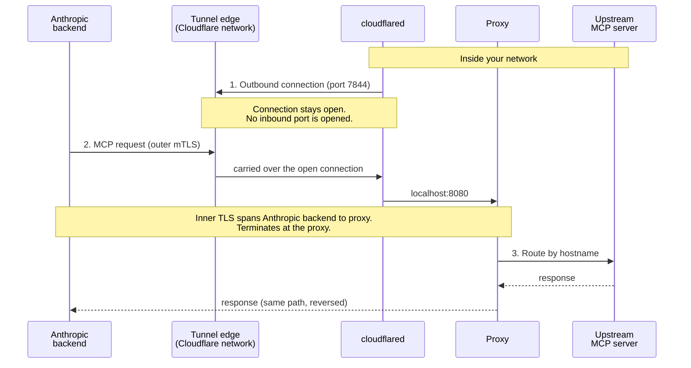

---
title: Arsitektur dan komponen
url: https://platform.claude.com/docs/id/agents-and-tools/mcp-tunnels/concepts
description: Nama kanonis untuk bagian-bagian deployment tunnel MCP, dua mode penyediaan kredensial, dan model koneksi.
---

<Note>
  MCP tunnels (terowongan MCP) sedang dalam pratinjau riset. [Minta akses](https://claude.com/form/mcp-tunnels) untuk mencobanya.
</Note>

Halaman ini mendefinisikan istilah yang digunakan di seluruh dokumentasi [Tunnel MCP](https://platform.claude.com/docs/id/agents-and-tools/mcp-tunnels/overview). Beberapa komponen muncul dengan nama yang berbeda dalam file konfigurasi, image container, dan teks prosa; tabel-tabel berikut memberikan satu nama kanonis untuk masing-masing komponen dan mencantumkan alias yang mungkin Anda temui.

## Komponen

| Istilah                 | Definisi                                                                                                                                                                                                                                                                                                                                          | Juga muncul sebagai                                                                                                                                                                                   |
| ----------------------- | ------------------------------------------------------------------------------------------------------------------------------------------------------------------------------------------------------------------------------------------------------------------------------------------------------------------------------------------------- | ----------------------------------------------------------------------------------------------------------------------------------------------------------------------------------------------------- |
| **Tunnel stack**        | Dua container yang Anda jalankan di dalam jaringan Anda untuk terhubung ke sebuah tunnel: proxy dan cloudflared. Satu stack melayani satu tunnel dan dapat direplikasi di beberapa host untuk ketersediaan. Dengan akses programatik, komponen setup berjalan berdampingan dengan stack untuk menyediakan kredensial.                             | stack, stack tunnel MCP, deployment tunnel, deployment Anda                                                                                                                                           |
| **Proxy**               | Komponen perutean milik Anthropic. Mengakhiri inner TLS, memvalidasi bahwa IP upstream berada dalam rentang yang diizinkan, dan merutekan setiap permintaan ke server MCP upstream berdasarkan hostname.                                                                                                                                          | `mcp-proxy` (nama image, nama layanan Compose, dan nama container Helm), `mcp-gateway` (path konfigurasi internal container `/etc/mcp-gateway/config.yaml` dan prefiks nilai Helm `gateway.config.*`) |
| **cloudflared**         | Konektor tunnel open-source milik Cloudflare. Memulai koneksi khusus-keluar (outbound-only) dari jaringan Anda ke tunnel edge dan membawa lalu lintas terenkripsi antara edge dan proxy. Tidak terkait dengan Managed Agent.                                                                                                                      | konektor keluar, konektor tunnel                                                                                                                                                                      |
| **Komponen setup**      | Biner `setup`, yang dikirimkan di dalam image `mcp-proxy`. Dengan akses programatik, komponen ini melakukan autentikasi melalui Workload Identity Federation, mengambil token tunnel, membuat CA dan sertifikat server, serta mendaftarkan CA tersebut ke Anthropic. Juga menyediakan `renew-cert`.                                               | setup Job (hook pre-install Helm), layanan `setup` (profil Compose), setup hook, setup binary, setup CLI                                                                                              |
| **Tunnel edge**         | Server edge Cloudflare yang dihubungi oleh cloudflared (rentang IP `198.41.192.0/19` dan `2606:4700:a0::/44`, port 7844 TCP dan UDP). Tunnel yang berjalan di atasnya disediakan dan dikendalikan oleh Anthropic; Cloudflare mengoperasikan jaringan yang mendasarinya.                                                                           | edge, tunnel edge yang dioperasikan Anthropic                                                                                                                                                         |
| **TLS dalam**           | Handshake TLS kedua yang dibawa di dalam aliran WebSocket plaintext milik tunnel, antara back end Anthropic dan proxy Anda. Proxy menyajikan sertifikat server yang ditandatangani oleh CA yang Anda daftarkan pada tunnel. Karena hanya Anda yang memegang kunci privat, penyedia transport tidak dapat membaca payload permintaan atau respons. | handshake TLS dalam                                                                                                                                                                                   |
| **Server MCP upstream** | Server MCP yang berjalan di jaringan privat Anda yang menjadi tujuan perutean proxy. Setiap upstream diekspos sebagai satu subdomain di bawah domain tunnel Anda.                                                                                                                                                                                 | upstream, server MCP yang dirutekan, server MCP yang di-tunnel                                                                                                                                        |

## Penyediaan kredensial

Tunnel stack membutuhkan dua kredensial saat runtime: **token tunnel**, yang mengautentikasi koneksi keluar cloudflared, dan **sertifikat server** yang ditandatangani oleh CA yang terdaftar pada tunnel, yang disajikan proxy selama handshake inner TLS. Ada dua cara untuk menyediakannya, yang disajikan di seluruh panduan ini sebagai sepasang tab.

| Mode                  | Bagaimana kredensial sampai ke stack                                                                                                                                                                                                                                                                                                                                                                              | Nama Helm chart                                 | Label tab                    |
| --------------------- | ----------------------------------------------------------------------------------------------------------------------------------------------------------------------------------------------------------------------------------------------------------------------------------------------------------------------------------------------------------------------------------------------------------------- | ----------------------------------------------- | ---------------------------- |
| **Akses programatik** | Komponen setup melakukan autentikasi ke Tunnels API melalui [Workload Identity Federation](https://platform.claude.com/docs/id/manage-claude/workload-identity-federation), mengambil token tunnel, membuat CA dan sertifikat server secara lokal, dan mendaftarkan CA tersebut. Tidak ada secret berumur panjang yang disalin secara manual. Memerlukan aturan federasi dengan scope `workspace:manage_tunnels`. | Mode terkelola (`setup.enabled: true`, default) | **Dengan akses programatik** |
| **Manual**            | Anda menyalin token tunnel dari Claude Console, membuat CA dan sertifikat server sendiri (misalnya dengan `openssl`), mendaftarkan CA di Console, dan menyediakan token serta sertifikat ke stack sebagai secret. Tidak ada komponen setup yang berjalan.                                                                                                                                                         | Mode eksternal (`setup.enabled: false`)         | **Tanpa akses programatik**  |

Mode-mode ini juga disebut sebagai **alur programatik** (the programmatic flow) dan **alur manual** (the manual flow) dalam panduan deployment.

## Model koneksi

Ada dua arah yang bekerja dalam sebuah tunnel, dan keduanya menunjuk ke arah yang berlawanan:

* **Arah koneksi:** cloudflared melakukan dial **keluar (outbound)** dari jaringan Anda ke tunnel edge. Firewall Anda hanya melihat egress pada port 7844; tidak ada port masuk yang dibuka.
* **Arah permintaan:** setelah koneksi tersebut terbentuk, permintaan MCP berjalan **dari Anthropic menuju jaringan Anda** melaluinya, melewati cloudflared ke proxy, dan diteruskan ke server MCP upstream.

Frasa “outbound-only” (khusus-keluar) menggambarkan koneksinya, bukan permintaan yang dibawa melaluinya.

TLS dalam membentang antara back end Anthropic dan proxy Anda. cloudflared dan tunnel edge berada di antara keduanya pada jalur transmisi tetapi hanya melihat ciphertext; proxy adalah tempat pertama di dalam jaringan Anda di mana payload permintaan MCP dapat dibaca.

## Lihat juga

* [Tunnel MCP](https://platform.claude.com/docs/id/agents-and-tools/mcp-tunnels/overview) untuk model keamanan dan tabel tanggung jawab bersama
* [Referensi MCP tunnels](https://platform.claude.com/docs/id/agents-and-tools/mcp-tunnels/reference) untuk field konfigurasi proxy, persyaratan sertifikat, dan komponen setup
