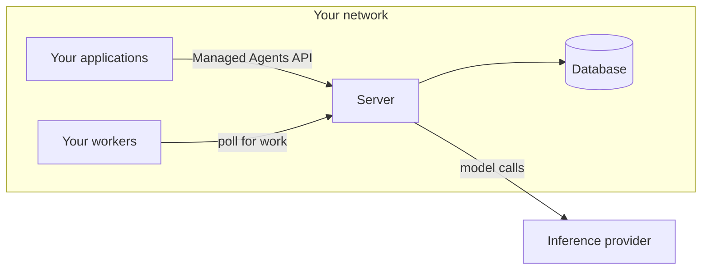

---
title: Claude Managed Agents yang di-host sendiri
url: https://platform.claude.com/docs/id/managed-agents/self-hosted
description: Host layanan Claude Managed Agents dan sandbox-nya di infrastruktur Anda sendiri. Pelajari siapa yang meng-host setiap bagian, kapan memilih opsi ini, dan dari mana harus memulai.
---

<Note>
  Untuk meminta akses ke Claude Managed Agents yang di-host sendiri, hubungi tim akun Anthropic Anda.
</Note>

Claude Managed Agents yang di-host sendiri adalah Managed Agents di infrastruktur Anda sendiri, yang dapat berupa akun cloud atau pusat data on-premise. Anda meng-host layanan dan sandbox. Model berjalan di Anthropic atau di penyedia yang Anda pilih.

Managed Agents memiliki dua bagian yang dapat Anda host:

* **Sandbox:** Container, VM, atau workspace terisolasi lainnya tempat alat-alat agen menjalankan perintah dan bekerja dengan file. Lihat [Sandbox yang di-host sendiri](https://platform.claude.com/docs/id/managed-agents/self-hosted-sandboxes).
* **Layanan:** API, agent loop, dan penyimpanan untuk agen, sesi, dan riwayat sesi.

Sandbox yang di-host sendiri memindahkan bagian pertama kepada Anda. Managed Agents yang di-host sendiri memperluas hal tersebut: Anda juga meng-host layanannya. Nama setiap opsi menunjukkan apa yang Anda host:

| Opsi                                                                                                     | Sandbox   | Layanan   | Model                                    |
| -------------------------------------------------------------------------------------------------------- | --------- | --------- | ---------------------------------------- |
| Sandbox cloud (default)                                                                                  | Anthropic | Anthropic | Anthropic                                |
| [Sandbox yang di-host sendiri](https://platform.claude.com/docs/id/managed-agents/self-hosted-sandboxes) | Anda      | Anthropic | Anthropic                                |
| Managed Agents yang di-host sendiri                                                                      | Anda      | Anda      | Anthropic, atau penyedia yang Anda pilih |

Di halaman-halaman ini, layanan yang di-hosting adalah layanan sebagaimana dijalankan oleh Anthropic, dan server Anda adalah layanan sebagaimana Anda jalankan, dengan database-nya sendiri. Keduanya memiliki API yang sama, sehingga SDK dan CLI `ant` berfungsi dengan server Anda, dan dokumentasi Managed Agents lainnya tetap berlaku. [Perbedaan dari layanan yang di-hosting](https://platform.claude.com/docs/id/managed-agents/self-hosted/differences) mencantumkan pengecualiannya.

<Note title="Baru mengenal Claude Managed Agents?">
  Claude Managed Agents menjalankan Claude sebagai agen otonom: Anda mendefinisikan agen, memulai sesi, dan bertukar event dengan agen selama agen bekerja. [Konsep inti](https://platform.claude.com/docs/id/managed-agents/overview#core-concepts) menjelaskan agen, environment, sesi, dan event. Anda tidak perlu menggunakan layanan yang di-hosting terlebih dahulu.
</Note>

## Kapan memilih Managed Agents yang di-host sendiri

Pilih Managed Agents yang di-host sendiri ketika Anda membutuhkan salah satu hal berikut:

* **Penyimpanan di infrastruktur Anda:** Anda harus menyimpan agen, sesi, dan riwayat sesi sendiri.
* **Penyedia inferensi pilihan Anda:** Panggilan model harus diarahkan ke Amazon Bedrock, Claude Models on Google Cloud (Google managed), Microsoft Foundry, atau gateway model Anda sendiri. Lihat [Penyedia inferensi](https://platform.claude.com/docs/id/managed-agents/self-hosted/inference-provider).

Jika Anda hanya memerlukan alat yang berjalan di infrastruktur Anda, gunakan sandbox yang di-host sendiri, dengan Anthropic yang menjalankan layanannya. Lihat [Memilih lingkungan agen](https://platform.claude.com/docs/id/managed-agents/choosing-an-environment).

Dengan Managed Agents yang di-host sendiri, Anda menjalankan dan mengamankan server, database-nya, dan sandbox Anda, dan Anda menginstal setiap rilis sendiri. Beberapa fitur hanya ada di layanan yang di-hosting, jadi periksa [Perbedaan dari layanan yang di-hosting](https://platform.claude.com/docs/id/managed-agents/self-hosted/differences) sebelum Anda memutuskan.

## Apa yang berjalan di mana

Satu atau beberapa server, database-nya, dan sandbox Anda membentuk satu deployment.

* **Server (`cma-server`):** Melayani API, menjalankan agent loop, dan menyimpan agen, sesi, dan riwayat setiap sesi. Server memanggil penyedia inferensi Anda setiap kali agen membutuhkan model. Server tidak pernah menjalankan alat shell atau file milik agen.
* **Database:** PostgreSQL 16 atau lebih baru. Tanpa database, server menyimpan datanya di memori, dan restart akan menghapusnya.
* **Worker:** Program yang mengambil pekerjaan dari server dan menjalankan alat shell dan file milik agen di sandbox Anda. Worker adalah perintah `ant beta:worker` atau worker SDK.
* **Aplikasi Anda:** Kode dan skrip Anda sendiri, yang menjangkau server dengan SDK atau CLI `ant`.
* **Console di server Anda:** Halaman web di alamat server, tempat pengguna masuk melalui penyedia identitas Anda untuk membuat agen dan menjalankan sesi. Lihat [Menggunakan console di server Anda](https://platform.claude.com/docs/id/managed-agents/self-hosted/console).
* **CLI admin (`cma-server-admin`):** Membuat environment dan kunci environment-nya. CLI ini berjalan di Linux (x86-64 dan Arm) serta macOS pada Apple silicon.

## Tanggung jawab keamanan Anda

<Warning>
  Alat `bash` milik agen adalah shell sungguhan dengan izin dan akses jaringan dari proses worker. Worker tidak mengisolasi shell tersebut. Isolasi berasal dari tempat worker berjalan. Stack Docker Compose dan Helm chart `cma-sandboxes` memulai worker setiap sesi dalam container atau pod-nya sendiri. Jika Anda memulai worker sendiri, jalankan worker tersebut dalam container atau VM sekali pakai yang tidak menyimpan apa pun yang perlu Anda lindungi.
</Warning>

[Model keamanan](https://platform.claude.com/docs/id/managed-agents/self-hosted-sandboxes-security) untuk sandbox yang di-host sendiri berlaku di sini, dengan dua perbedaan. Hal-hal yang oleh halaman tersebut ditetapkan sebagai tanggung jawab Anthropic menjadi tanggung jawab Anda, termasuk mengamankan server, meng-host memory store, dan mendeteksi penggunaan yang tidak biasa. Halaman tersebut juga menyarankan workspace dan environment terpisah untuk setiap batas kepercayaan. Di sini, setiap tingkat kepercayaan memerlukan deployment-nya sendiri, seperti yang dijelaskan di [Multitenansi](https://platform.claude.com/docs/id/managed-agents/self-hosted-data-and-access#multitenancy).

## Tiga kredensial

| Kredensial               | Siapa yang memegangnya                       | Apa yang diautentikasi                                                                                                                                                                                                                |
| ------------------------ | -------------------------------------------- | ------------------------------------------------------------------------------------------------------------------------------------------------------------------------------------------------------------------------------------- |
| **Kunci API server**     | Aplikasi Anda, CLI `ant`, dan admin CLI      | Permintaan ke server Anda. Proses penyiapan menghasilkan kunci ini. Kunci ini memainkan peran yang dimainkan kunci API Claude pada layanan yang di-hosting.                                                                           |
| **Kredensial inferensi** | Server                                       | Panggilan model dari server ke penyedia inferensi Anda. Misalnya, kredensial ini dapat berupa kunci API Claude, kredensial penyedia cloud Anda, atau token yang diterima gateway model Anda. Aplikasi dan worker tidak memerlukannya. |
| **Kunci environment**    | Worker Anda yang melakukan polling ke server | Antrean pekerjaan satu environment dan sesi-sesi environment tersebut.                                                                                                                                                                |

## Apa yang keluar dari jaringan Anda

Untuk setiap panggilan model, server mengirimkan percakapan sejauh ini, termasuk input alat dan hasil alat, ke penyedia inferensi Anda. Secara default, itu adalah Claude API. Panggilan ke Claude API juga membawa ID sesinya serta ID agen dan environment dari sesi tersebut. [Data dan akses dalam Claude Managed Agents yang di-host sendiri](https://platform.claude.com/docs/id/managed-agents/self-hosted-data-and-access) mencantumkan setiap koneksi yang dibuat server. Halaman tersebut juga menjelaskan ke mana log dikirim dan siapa yang dapat menjangkau server.

## Dari mana harus memulai

Untuk meminta akses ke unduhan, hubungi tim akun Anthropic Anda. Lalu ikuti [Memulai dengan Claude Managed Agents yang di-host sendiri](https://platform.claude.com/docs/id/managed-agents/self-hosted/quickstart) untuk memulai server dan menjalankan sesi pertama.

Arsip setiap rilis menyertakan panduan operator untuk versi tersebut, `operator-guide.md`. Minta Claude membaca file tersebut, sehingga Claude dapat membantu Anda mengonfigurasi dan menjalankan server Anda serta menulis kode yang terhubung ke server tersebut.

## Lisensi

Perangkat lunak server dilisensikan berdasarkan [Perjanjian Lisensi Perangkat Lunak: Claude Managed Agents Server](https://www.anthropic.com/legal/self-hosted-managed-agents-license).
